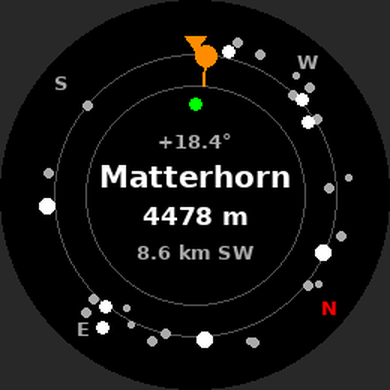

# PeakFinder CH — Garmin Forerunner 255 Music

Point the watch at a mountain and it tells you which summit it is.
It covers 784 Swiss summits in 28 massifs and works fully offline.



## Build and install

1. In VS Code: **File > Open Folder** and choose this `PeakFinder` folder.
2. `Ctrl+Shift+P` → **Monkey C: Build for Device** → Forerunner 255 Music.
3. Copy the `.prg` file it creates into `GARMIN/APPS` on the watch, then eject it.
4. On the watch: **Start** → scroll down → **Ajouter** → **PeakFinder CH**.

The first time, it asks to use GPS. Go outside so it gets a fix.

### Testing in the simulator

Run it with `Ctrl+F5`. The simulator starts in the USA, so set a Swiss position with
**Simulation > Set Position**, for example Zermatt `46.0207, 7.7491`
or Grindelwald `46.6244, 8.0414`.
The simulator usually has no compass, so the ring stays north-up.

## Screens and buttons

**Radar (main screen)**
- The ring turns with the watch. The orange marker at the top is where you are facing.
- The dots are summits. Further out on the ring means further away. Bigger dots mean more prominent summits.
- The summit you face is shown in orange, with its name, height and distance in the centre.
- The figure above the name (e.g. `+18.4°`) is how high above the horizon to look. It accounts for the earth's curvature.
- The dot under the ring shows GPS status: green good, yellow weak, grey last known position.

| Button | Action |
|---|---|
| UP / DOWN | Step through the summits around the ring (manual mode) |
| BACK | Leave manual mode (back to following the compass), then exit |
| START | Details of the highlighted summit |
| Hold UP | Menu: nearby list, radius, minimum prominence |

**Details**: shows an arrow that turns green when you point straight at the summit.
It also shows height, prominence, distance, bearing, viewing angle and massif.
UP and DOWN go to the next summit by distance.

**Menu**
- Radius: 10 / 20 / 40 / 80 km.
- Minimum prominence: 150 / 300 / 500 / 1000 m. Raise it to see only the major summits.
- Both settings are remembered.

## How it stays small on the watch

The summits are split into 30 small tiles of 0.5° × 0.5°, stored as JSON resources (about 31 KB in total).
When you move more than 1 km, the app loads the tiles that overlap the search circle one at a time.
From each tile it keeps the most prominent summits within the radius, at most 30 in total, and then lets the tile go.
Each tile is sorted by prominence, so the scan stops early. The arithmetic is plain flat-earth maths with one cosine per tile.
At 80 km it is within 0.4° of the exact bearing and 0.05 % of the exact distance.

## The data

- `data/peaks.csv` lists every summit included, with its massif and sources.
- Selection rule: prominence of at least 150 m. Four well-known viewpoints with 100–150 m are also kept: Uetliberg, Schnebelhorn, Pic Chaussy and Dent de Jaman.
- Main sources are the Wikipedia lists of mountains for each canton. Their heights and prominences come from swisstopo 1:25,000 maps. The canton lists used are VS, BE, GR, TI, UR, GL, SG, AI, AR, SZ, OW and NW.
- The Jura, the Fribourg/Vaud Prealps and the Plateau come from the list of most-isolated Swiss mountains, the list of prominent Alpine peaks of 2000–2499 m, and individual summit articles.
- Rows from different sources were merged and cross-checked. Each list was checked against the area its massif covers. Six rows whose coordinates were clearly wrong were left out: Druesberg (canton list version), Pilatus (OW/NW version), Huetstock, Hagleren, Monte Lema and Mont de la Fouly. Druesberg and Pilatus are still included from their other sources.
- Gaps: the Jura and Prealps are covered by their main summits only. There is nothing in Geneva, Basel or Schaffhausen, which have no summit with 150 m prominence. The watch shows "No summit within … km" there.

### Rebuilding the data (e.g. from swissNAMES3D)

```
python3 tools/merge.py tools/raw out          # merge + validation report
python3 tools/pack.py out/peaks_merged.json . # writes resources/tiles, source/TileIndex.mc, data/peaks.csv
python3 tools/check_model.py .                # compares the watch's search with an exact one
```

To switch to swisstopo's own swissNAMES3D summit points, add them as another CSV in `tools/raw`.
Use the same columns: `name;height_m;prominence_m;lat;lon;range;src`.

## Limits

- The app does not know the terrain, so it cannot tell whether a closer ridge hides a summit.
- Compass accuracy depends on calibration. Calibrate it from **Settings > Sensors > Compass**.
- The viewing angle uses GPS altitude, which can be off by 10–20 m.
- Only `fr255m` is in the manifest. For the 255 / 255S / 255S Music, add their product ids and download those devices in the SDK Manager.
